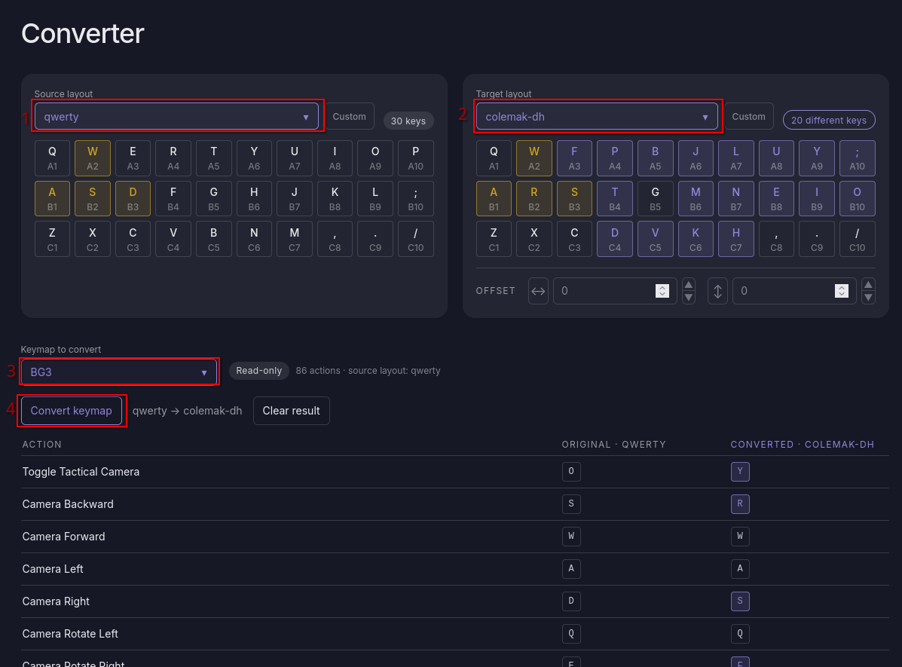
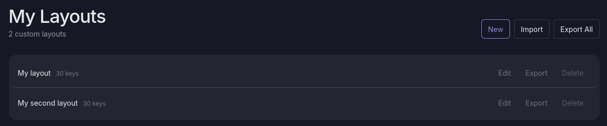
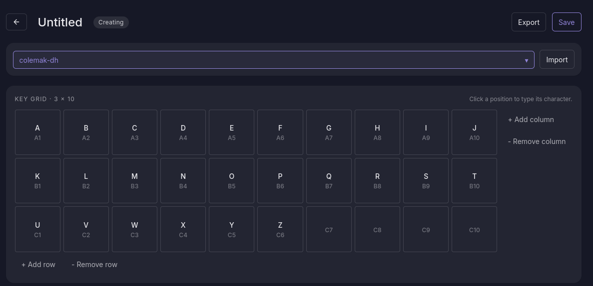
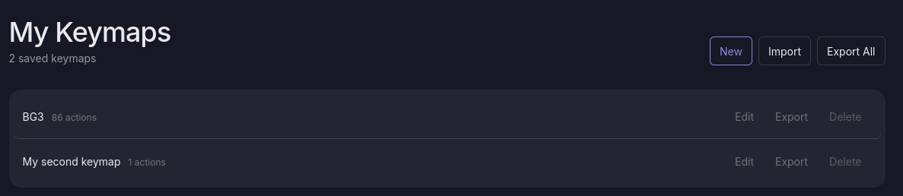
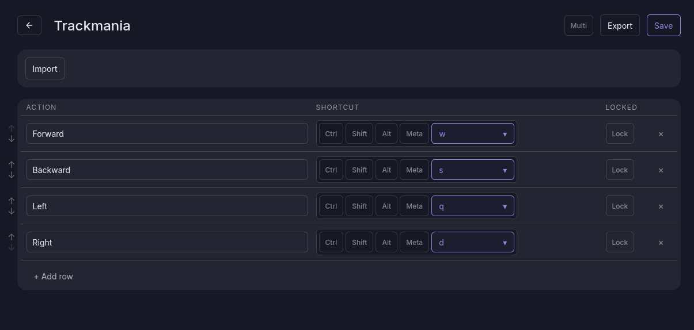

# BindMirror

Carry your keyboard shortcuts over when you change keyboard layout.

BindMirror remaps a keymap from one layout to another by **physical key position**. A shortcut bound to `W` on QWERTY lands on whatever key sits at that same position on Colemak, Dvorak, Bepo or any layout you define, so the shortcut keeps the same place under your fingers.

Everything runs in the browser. There is no backend: your layouts and keymaps are stored in `localStorage`.

Try it online: https://bindmirror-0bfcf9.gitlab.io



## How it works

1. Pick the layout your shortcuts were made for (for example qwerty) and the layout you are moving to.
2. Pick or create the keymap to convert.
3. Convert: the result table shows the new key for each action, with the changed ones highlighted.
4. Rebind the changed shortcuts in your game or app, following the table.

BindMirror does not change any game or app settings: it tells you which keys to rebind, and you apply them yourself.

## Features

- **Convert** a keymap between two layouts, with a preview of the changed keys and the result as a table.
- **Offsets**: shift the mapping by columns and rows, with wrapping, when two layouts place a key cluster (for example `WASD`) at different spots.
- **Layout presets**: qwerty, qwertz, azerty, colemak, colemak-dh, dvorak, bepo, workman, neo2, jcuken.
- **Custom layouts**: build a layout on a resizable key grid, or start from a preset.
- **Custom keymaps**: define actions with single keys, modifiers, or multi-step shortcuts (chords), reorder them, and lock the ones that must not be remapped.
- **Import and export** layouts and keymaps as JSON files.

## Screenshots

| My layouts | Layout editor |
| --- | --- |
|  |  |

| My keymaps | Keymap editor |
| --- | --- |
|  |  |

## Getting started

Requires Node.js and npm.

```bash
npm install
npm start
```

The app is then available at http://localhost:4200.

## Run with Docker

```bash
docker compose up --build
```

The app is then available at http://localhost:8080. Without Compose:

```bash
docker build -t bindmirror .
docker run --rm -p 8080:80 bindmirror
```

The image builds the app with Node and serves the static output with Nginx, which falls back to `index.html` so that direct links to routes such as `/my-layouts` work.

## Scripts

| Command | Description |
| --- | --- |
| `npm start` | Development server |
| `ng build` | Production build in `dist/bindmirror` |
| `ng test --watch=false` | Run the test suite once (Vitest, jsdom) |
| `npm run format` | Format `src/**/*.{ts,html}` with Prettier |

## Documentation

Technical documentation is in [`docs/`](docs/README.md): architecture, data model, conversion algorithm, services, components, persistence and import/export, styling, and testing.

## Tech stack

Angular 22 (standalone components, signals), Angular CDK, Tailwind CSS v4, TypeScript, Vitest.

## Contributing

Issues and merge requests are welcome. Before opening a merge request, run `ng test --watch=false` and `npm run format`. Read [`docs/styles.md`](docs/styles.md) before changing templates or classes.

## License

[MIT](LICENSE)
